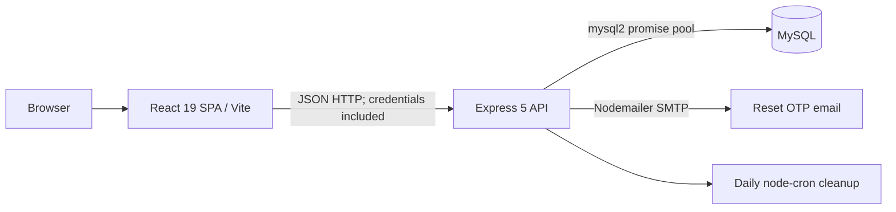
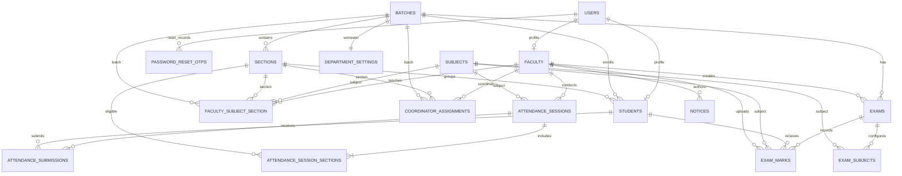
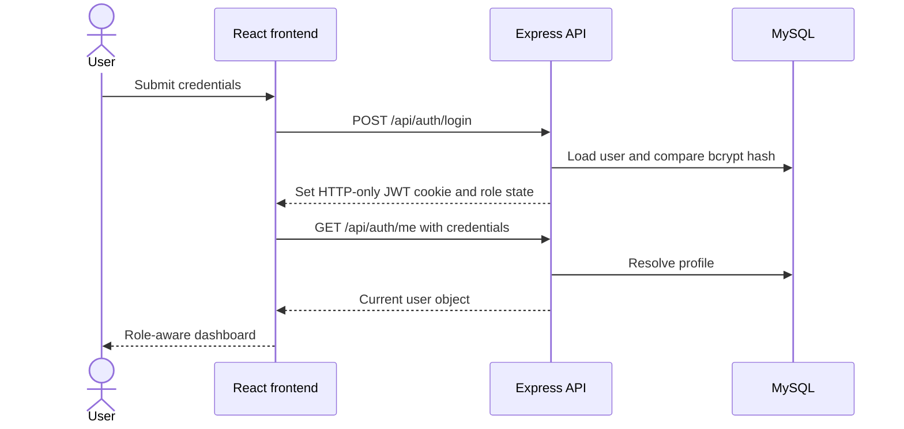
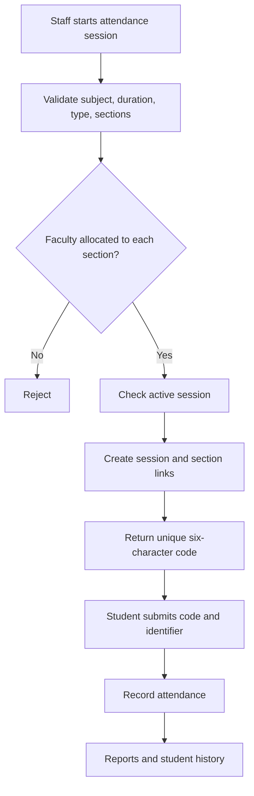
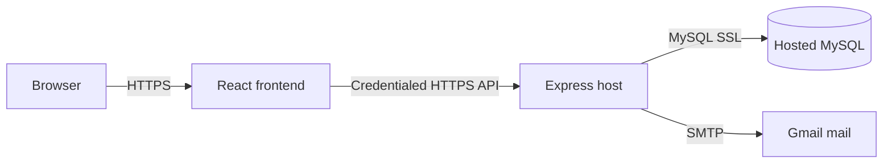

# College Department Management System

A role-based departmental administration application. The connected application is a React/Vite SPA in `Frontend/`, an Express API in `Backend/`, and a MySQL database. `UIX/` is an independent Vite/React project and is not connected to the backend or active route tree.

## Table of Contents

- [1. Project Overview](#1-project-overview)
  - [Introduction](#introduction)
  - [Problem, objectives, scope, and users](#problem-objectives-scope-and-users)
- [2. Key Features](#2-key-features)
- [3. User Roles and Permissions](#3-user-roles-and-permissions)
  - [3.1 HOD](#31-head-of-department-hod)
  - [3.2 Faculty](#32-faculty)
  - [3.3 Student](#33-student)
  - [3.4 Permission Matrix](#34-role-based-permission-matrix)
- [4. System Architecture](#4-system-architecture)
- [5. Technology Stack](#5-technology-stack)
- [6. Project Directory Structure](#6-project-directory-structure)
- [7. Functional Modules](#7-functional-modules)
- [8. Database Design](#8-database-design)
  - [8.1 Overview](#81-overview)
  - [8.2 ER Diagram](#82-entity-relationship-diagram)
  - [8.3 Tables](#83-tables-and-column-inventory)
  - [8.4 Relationships and limitations](#84-relationships-business-rules-and-verification-limits)
- [9. Authentication and Authorization](#9-authentication-and-authorization)
- [10. API Documentation](#10-api-documentation)
- [11. Application Workflows](#11-application-workflows)
- [12. User Interface and Navigation](#12-user-interface-and-navigation)
- [13. Installation and Setup](#13-installation-and-setup)
- [14. Environment Configuration](#14-environment-configuration)
- [15. Running the Application](#15-running-the-application)
- [16. Deployment](#16-deployment)
- [17. Future Scope and Conclusion](#17-future-scope-and-conclusion)

## 1. Project Overview

### Introduction

The College Department Management System centralizes implemented departmental workflows: user records, academic structure, faculty assignments, attendance, examinations, marks, notices, and role-specific academic views.

### Problem, Objectives, Scope, and Users

Department records and activities can be fragmented across separate processes. This system provides a shared interface and data store with authenticated, role-aware operations. Its scope includes HOD, faculty, and student views; student applications; faculty/student records; batches, sections, assignments; attendance; exams and marks; notices; dashboards; profiles; and batch-semester settings. Assignment submission, project tracking, messaging, and course-content delivery are not implemented in the active app.

- **HOD:** manages department records, academic configuration, and review workflows.
- **Faculty:** works with teaching/coordinator scope, attendance, student lists, exams/marks, and notices.
- **Student:** views own dashboard, attendance, marks, and notices; can apply for enrollment.

## 2. Key Features

- Login/logout, current-user lookup, OTP password reset, and first-login state.
- Student/faculty record management, account activation, and HOD student-application review.
- Batch/section browsing, coordinator assignment, faculty-subject-section allocation, and semester promotion.
- Timed attendance sessions with generated six-character codes, student submissions, reports, and attendance history.
- Exam configuration with subject maximum marks; faculty/HOD mark entry and student result access.
- Role-specific dashboards, notices, profiles, academic settings, and a daily cleanup job for OTPs older than 30 days.
- Vercel SPA history fallback for the active frontend.

## 3. User Roles and Permissions

Backend middleware and service checks are authoritative; frontend role page selection is only navigation.

### 3.1 Head of Department (HOD)

HOD-only operations include reviewing student signup requests, assigning coordinators, mutating subject allocations, creating/updating/deleting exams, and promoting batches. HOD can also access dashboards, user records, attendance, marks, notices, profiles, department settings, and academic structure.

### 3.2 Faculty

Faculty can view own allocations, assigned coordinator sections and students, batches/sections, attendance sessions/history/reports, scoped exams and marks, student views, notices, dashboards, and profiles. Shared user and notice routes allow faculty subject to service checks. Faculty cannot call HOD-only allocation mutations, coordinator assignment, exam configuration, application review, or semester promotion.

### 3.3 Student

Students can access own dashboard/profile, attendance summary/history and attendance submission, notices, batch-scoped exams, and own marks. Signup is public; HOD approval creates the account. Student endpoints do not provide roster or marks mutation.

### 3.4 Role-Based Permission Matrix

| Module | HOD | Faculty | Student |
|---|---|---|---|
| Authentication, dashboard, own profile | Yes | Yes | Yes |
| User directory/create/update/status | Yes | Yes, service checks | No |
| Signup applications | Review/approve | No | Public application |
| Coordinator assignments | Manage/view | View; own sections/rosters | No |
| Subject allocation | Create/update/delete; view all | View own | No |
| Batches and sections | View | View | No |
| Department semester settings | View/promote | No | No |
| Attendance | Manage/history/reports | Manage, scoped by service | Submit/view own |
| Exams | Create/update/delete; view | View in teaching/coordinator scope | View own batch |
| Marks | Read/write/delete | Read/write in scope | Read own |
| Notices | Create/read/update/delete | Create/read/update/delete, ownership checks | Read |

## 4. System Architecture

### High-Level, Frontend, Backend, and Data Flow

`Frontend/src/App.jsx` defines public auth/signup routes and protected modules. `ProtectedRoute` calls `/api/auth/me`; `DashboardLayout` renders shared navigation/header; `ModuleRouter` chooses a role-specific page. Requests use `VITE_API_URL` and cookie credentials. Backend `app.js` configures CORS, JSON/cookie parsing, API routers, and cleanup scheduling.

Typical protected request flow is **Routes → Middleware → Controllers → Services → Database**. Auth logic also performs some SQL directly in its controller. The MySQL pool is created in `Backend/src/config/db.js`.



Client requests carry JSON and, where needed, the HTTP-only cookie. Services use parameterized SQL; several multi-record operations use transactions.

## 5. Technology Stack

| Area | Actual technologies |
|---|---|
| Frontend | React 19, React Router 7, Vite 7, Tailwind CSS 4, Lucide React, Sonner |
| Backend | Node.js/CommonJS, Express 5, mysql2/promise, dotenv |
| Database | MySQL |
| Security | bcrypt, jsonwebtoken, cookie-parser, cors |
| Supporting services | Nodemailer with Gmail transport, node-cron |
| Development | npm, ESLint 9, nodemon |

`UIX/` has a separate package manifest and is not the connected frontend described here.

## 6. Project Directory Structure

```text
CollegeDepartment/
├── Backend/
│   ├── server.js
│   ├── package.json
│   └── src/{app.js,config/,routes/,middlewares/,controllers/,services/,utils/}
├── Frontend/
│   ├── vercel.json
│   ├── vite.config.js
│   ├── package.json
│   └── src/{App.jsx,components/,config/,context/,layout/,routes/,pages/}
├── LICENSE
└── README.md
```

Backend routes declare APIs; middleware verifies JWT/roles; controllers handle HTTP; services contain domain logic and SQL; config creates the pool; utils implement OTP/token/attendance helpers. Frontend routes/layout/components provide navigation and shared UI; pages cover auth, dashboard, attendance, marks, exams, students, faculty, coordinators, allocations, sections, notices, signup, and settings.

## 7. Functional Modules

- **Authentication/registration:** login checks active state and bcrypt password, updates last login, and issues a one-day JWT cookie. Reset uses hashed ten-minute OTP emailed through Nodemailer, verification yields a signed reset token, and confirmation updates the password. Public student applications become user/student records only after HOD approval.
- **Dashboard/profile:** role-specific dashboard data is returned by `/api/dashboard`. Profile endpoints operate on the authenticated user's own profile; the service controls editable fields.
- **Faculty/student management:** `/api/users` supports create/list/detail/update/activation for HOD and faculty at route level, with additional role-aware service validation. HOD views provide directories and forms.
- **Academic structure/coordinators:** HOD assigns a coordinator to a section/batch pair. Faculty can retrieve their coordinated sections and associated rosters. Section identifiers are checked in batch context.
- **Subject allocation:** HOD assigns faculty, subject, section, and batch. The service validates references and rejects duplicate subject assignment for a section/batch. Faculty reads are filtered to self.
- **Attendance:** HOD/faculty start sessions for one or more section/batch pairs. Service accepts THEORY/LAB, REGULAR category, UNIQUE_ID method; checks allocation for faculty and prevents concurrent active sessions per faculty. Students submit session code and identifier; users see scoped history/reports.
- **Exams/marks:** HOD creates exam headers and subject maxima; validation checks batch, semester and subject allocation. Faculty access is scoped by teaching/coordinator assignment. Marks validation checks exam, subject, section, student roster, and maximum marks. Students query their own result.
- **Notices/settings:** HOD/faculty write notices; all roles read, with service ownership checks for edits. HOD views semester-by-batch settings and promotes one step up to semester 8.

## 8. Database Design

### 8.1 Overview

A shared `mysql2/promise` pool accesses MySQL. The repository contains no DDL, schema export, migration, or seed file. The inventory below is derived from SQL references and may not be complete.

### 8.2 Entity Relationship Diagram

Cardinalities are inferred from joins/inserts. Exact FK definitions and cascade actions require the database DDL.



### 8.3 Tables and Column Inventory

No SQL data types, nullability, defaults, PK/FK declarations, indexes, unique constraints, or cascade actions can be verified. Columns are directly referenced in backend SQL; some lists are incomplete.

| Table | Purpose | Referenced columns |
|---|---|---|
| `users` | Login identity | `user_id`, `email`, `password_hash`, `role`, `is_active`, `is_first_login`, `last_login` |
| `students` | Student profile | `student_id`, `user_id`, `enrollment_number`, `name`, `phone`, `section_id`, `batch_id` |
| `faculty` | Faculty/HOD profile | `faculty_id`, `user_id`, `name`, `designation` |
| `batches` | Admission cohort | `batch_id`, `admission_year` |
| `sections` | Batch section | `section_id`, `batch_id`, `section_name`, `intake_strength` |
| `subjects` | Subject catalog | `subject_id`, `subject_code`, `subject_name`, `semester` |
| `department_settings` | Semester per batch | `batch_id`, `current_semester` |
| `coordinator_assignments` | Coordinator mapping | `assignment_id`, `faculty_id`, `section_id`, `batch_id`, `assigned_date` |
| `faculty_subject_section` | Teaching assignment | `allocation_id`, `faculty_id`, `subject_id`, `section_id`, `batch_id` |
| `attendance_sessions` | Attendance session | `session_id`, `subject_id`, `faculty_id`, `session_code`, `present_strength`, `session_type`, `attendance_category`, `attendance_method`, `start_time`, `end_time`, `status` |
| `attendance_session_sections` | Session eligible groups | `id`, `session_id`, `section_id`, `batch_id` |
| `attendance_submissions` | Student attendance | `submission_id`, `session_id`, `student_id`; more reporting fields are used |
| `exams` | Exam header | `exam_id`, `exam_name`, `batch_id`, `semester`, `academic_year`, `created_by`, `created_at` |
| `exam_subjects` | Exam subjects/maxima | `exam_id`, `subject_id`, `max_marks` |
| `exam_marks` | Student results | `mark_id`, `exam_id`, `student_id`, `subject_id`, `marks_obtained`, `attendance_status`, `uploaded_by` |
| `notices` | Department notices | `id` and author/title/content/date fields referenced in service queries; full list needs DDL |
| `password_reset_otps` | OTP/reset lifecycle | `otp_id`, `user_id`, `otp_hash`, `expires_at`, `verified`, `used`, `created_at` |
| `student_signup_requests` | Enrollment applications | `request_id`, `full_name`, `email`, `phone_number`, `enrollment_number`, `batch_id`, `section_id`, `status`, `reviewed_at` |

### 8.4 Relationships, Business Rules, and Verification Limits

- User profiles join through `user_id`; HOD profile lookup follows the faculty table.
- Students carry batch and section; services verify their association. Department settings map batch to semester and promotion is transactional, one step at a time, through semester 8.
- Teaching assignments and coordinator assignments are separate concepts, both scoped to section/batch.
- Attendance sessions link to multiple allowed section/batch rows; submissions link student to session. Reports derive attendance status from roster and submissions.
- Exams and exam-subject maxima are separated from per-student marks.
- OTPs are hashed, expire after ten minutes, and old rows are cleaned daily after 30 days.
- Services validate assignment uniqueness and cross-entity consistency; selected multi-row operations use transactions.

Exact data types and constraints cannot be documented without DDL. The service checks whether `exam_marks.attendance_status` exists at runtime, indicating compatibility with differing database versions. `student_signup_requests` has no evident user FK in application queries. Treat this source-derived inventory as explanatory only, not as a migration specification.

## 9. Authentication and Authorization

Login checks account activation and bcrypt password, updates last login, and signs a JWT using `JWT_SECRET` with one-day expiry. It sets cookie `token` with `httpOnly`, `sameSite: "lax"`, one-day max age, and `secure` only when `NODE_ENV=production`. HTTP-only cookies prevent client JavaScript from directly reading the token; frontend requests include credentials.

`verifyToken` validates the cookie and attaches `userId` and role. `authorizeRoles` checks route allowlists and returns 401/403. Services add ownership/assignment scope checks. Frontend `ProtectedRoute` checks `/api/auth/me`, but is not the security boundary. Logout clears the cookie. OTPs are bcrypt-hashed, emailed via Gmail/Nodemailer, and valid for ten minutes; a verified OTP yields a signed reset token. CORS uses `CLIENT_URL` with credentials enabled.

## 10. API Documentation

All paths below are mounted under `/api`. Protected endpoints require the token cookie, except public auth/signup routes. Service-backed modules usually return `{ success, message, data }`; specific response shapes are noted where explicit. Body fields beyond those described should be confirmed in the corresponding service before client integration.

### Authentication

| Method | Endpoint | Request / response | Access |
|---|---|---|---|
| POST | `/auth/login` | `{ email, password }`; message, role, `is_first_login`; sets cookie | Public |
| POST | `/auth/logout` | Clears cookie; message | Public |
| GET | `/auth/me` | `{ authenticated, user: { id, name, email, role } }` | Auth |
| POST | `/auth/reset-password/request` | `{ email }`; generic success response | Public |
| POST | `/auth/reset-password/verify` | `{ email, otp }`; returns `resetToken` | Public |
| POST | `/auth/reset-password/confirm` | `{ newPassword }`; reset token required | Reset token |

### Users, signup, and academic structure

| Method | Endpoint | Purpose / body | Access |
|---|---|---|---|
| POST | `/users` | Create user/profile; role-specific service payload | HOD, Faculty |
| GET | `/users` | List; optional query filters; returns count/users | HOD, Faculty |
| GET | `/users/:id` | User detail | HOD, Faculty |
| PATCH | `/users/:id` | Update user/profile | HOD, Faculty |
| PATCH | `/users/:id/status` | `{ is_active }` | HOD, Faculty |
| GET | `/student-signup/options` | Batch/section signup options | Public |
| POST | `/student-signup` | Applicant identity and placement request | Public |
| GET | `/student-signup?status=` | Review queue | HOD |
| PATCH | `/student-signup/:requestId` | Body includes review `status` | HOD |
| GET | `/batches` | Batch list | HOD, Faculty |
| GET | `/sections` | Section list | HOD, Faculty |
| GET | `/subject-allocation/:batchId` | Subjects for configured batch semester | HOD |
| GET | `/faculty-subject-sections` | All allocations (HOD); own only (faculty) | HOD, Faculty |
| GET | `/faculty-subject-sections/faculty/:facultyId` | Allocations by faculty | HOD, Faculty |
| POST | `/faculty-subject-sections` | `{ facultyId, subjectId, sectionId, batchId }` | HOD |
| PATCH | `/faculty-subject-sections/:allocationId` | Same allocation fields | HOD |
| DELETE | `/faculty-subject-sections/:allocationId` | Delete allocation | HOD |
| GET | `/coordinators` | Assignment list | HOD, Faculty |
| GET | `/coordinators/section/:sectionId/:batchId` | Coordinator for pair | HOD, Faculty |
| GET | `/coordinators/faculty/:facultyId` | Controller reads `faculty_id` from GET body | HOD, Faculty |
| GET | `/coordinators/my-sections` | Current faculty's sections | Faculty |
| GET | `/coordinators/my-sections/:sectionId/:batchId/students` | Assigned roster | Faculty |
| PATCH | `/coordinators/:sectionId/:batchId` | Controller expects `facultyId` route param, but route omits it | HOD |
| GET | `/department-settings` | Batch semester settings | HOD |
| PATCH | `/department-settings/:batchId/promote` | Promote semester by one | HOD |

### Attendance

| Method | Endpoint | Request / purpose | Access |
|---|---|---|---|
| POST | `/attendance/start-session` | Subject, type, strength, duration, sections `[{sectionId,batchId}]`; optional category/method | HOD, Faculty |
| GET | `/attendance/active` | Current active session | HOD, Faculty |
| GET | `/attendance/session/:sessionId` | Session detail | HOD, Faculty |
| GET | `/attendance/session/:sessionId/live` | Live session state | HOD, Faculty |
| POST | `/attendance/end-session` | `{ sessionId }` | HOD, Faculty |
| GET | `/attendance/history` | Staff history | HOD, Faculty |
| POST | `/attendance/mark` | Session code and student identifier | Student |
| GET | `/attendance/student` | Own summary | Student |
| GET | `/attendance/student/history` | Own detailed history | Student |
| GET | `/attendance/report` | Report with query filters | HOD, Faculty |

### Exams and marks

| Method | Endpoint | Request / purpose | Access |
|---|---|---|---|
| POST | `/marks/exams` | `{ examName, batchId, semester, academicYear, subjects:[{subjectId,maxMarks}] }` | HOD |
| GET | `/marks/exams` | Role-scoped list | All roles |
| GET | `/marks/subjects?batchId=&semester=` | Subject lookup | HOD |
| GET | `/marks/assignments` | Mark entry assignments | Faculty |
| GET | `/marks/exams/:examId` | Exam detail | All roles |
| GET | `/marks/exams/:examId/students?subjectId=&sectionId=` | Roster/marks | HOD, Faculty |
| PATCH | `/marks/exams/:examId` | Update exam | HOD |
| DELETE | `/marks/exams/:examId` | Delete exam | HOD |
| POST | `/marks` | Save marks; service validates exam/subject/section/students | HOD, Faculty |
| GET | `/marks?examId=&subjectId=&studentId=` | Query marks; scoped by service | All roles |
| PATCH | `/marks/:markId` | Update mark | HOD, Faculty |
| DELETE | `/marks/:markId` | Delete mark | HOD |

### Dashboard, notices, and profile

| Method | Endpoint | Purpose | Access |
|---|---|---|---|
| GET | `/dashboard` | Role-specific dashboard payload | All roles |
| POST | `/notices` | Create; payload validated by service | HOD, Faculty |
| GET | `/notices` | List notices | All roles |
| GET | `/notices/:id` | Notice details | All roles |
| PATCH | `/notices/:id` | Update with service ownership rules | HOD, Faculty |
| DELETE | `/notices/:id` | Delete with service ownership rules | HOD, Faculty |
| GET | `/profile` | Current profile | All roles |
| PATCH | `/profile` | Update current profile | All roles |

## 11. Application Workflows

### Login and authentication



### Signup, allocation, and attendance

Public signup records an application. HOD approval validates duplicates and placement and transactionally creates user/student records. HOD allocation binds faculty, subject, section, and batch; services reject invalid or duplicate assignments. Faculty scope is checked before attendance actions.



### Exams, marks, and notices

HOD configures an exam and subject maxima. Faculty with teaching/coordinator scope load rosters and submit marks; service checks exam/subject/section/student consistency and maximum. Students read their own results. HOD/faculty publish notices; all roles read them, while changes are checked by service ownership rules.

## 12. User Interface and Navigation

The active UI uses a shared header/navigation and dashboard shell. HOD navigation includes students, applications, faculty, coordinators, allocations, marks, exams, attendance, notices, and settings. Faculty sees students, section, exams, marks, attendance, notices, and settings. Students see dashboard, attendance, marks, notices, and settings. `ModuleRouter` selects role-specific page files and shows “Page not available” when none exists.

Reusable elements include shared header/navigation, toasts, attendance/marks hooks and tables, directory forms, coordinator/allocation forms, and profile/academic settings. Theme preference is kept in local storage. Responsive utility classes exist; no formal device/accessibility QA is documented.

## 13. Installation and Setup

### Prerequisites

- Node.js/npm compatible with Vite 7 and Express 5.
- Reachable MySQL with required schema and reference data.
- Gmail SMTP credential/app password if password reset mail is needed.

```bash
git clone <repository-url>
cd CollegeDepartment/Backend
npm install
```

In another terminal:

```bash
cd CollegeDepartment/Frontend
npm install
```

No schema import, migrations, or seed script is present. Provision the database from authoritative DDL before starting the server. `UIX/` is not required for the connected app.

## 14. Environment Configuration

### 14.1 Backend Environment Variables

| Variable | Purpose |
|---|---|
| `PORT` | HTTP port; defaults to 3000 |
| `DATABASE_URL` | MySQL connection URI |
| `JWT_SECRET` | JWT signing/verification secret |
| `CLIENT_URL` | Allowed credentialed CORS origin |
| `NODE_ENV` | Sets secure cookie flag in production |
| `EMAIL_USER` | Gmail SMTP sender |
| `EMAIL_PASS` | Gmail SMTP credential/app password |

Example `Backend/.env`:

```dotenv
PORT=3000
DATABASE_URL=mysql://<user>:<password>@<host>:3306/<database>
JWT_SECRET=<long-random-secret>
CLIENT_URL=http://localhost:5173
NODE_ENV=development
EMAIL_USER=<sender@example.com>
EMAIL_PASS=<mail-app-password>
```

### 14.2 Frontend Environment Variables

| Variable | Purpose |
|---|---|
| `VITE_API_URL` | Backend origin without an `/api` suffix |

Example `Frontend/.env.local`:

```dotenv
VITE_API_URL=http://localhost:3000
```

Vite variables are client-visible; do not put secrets in the frontend environment. Some request sites fall back to same-origin when this variable is empty.

## 15. Running the Application

Backend development:

```bash
cd Backend
npm run dev
```

Backend normal start:

```bash
cd Backend
npm start
```

Frontend development:

```bash
cd Frontend
npm run dev
```

Vite prints the local URL (normally port 5173); API defaults to port 3000. Set `CLIENT_URL` to the exact frontend origin. Production frontend build/preview:

```bash
cd Frontend
npm run build
npm run preview
```

Frontend also defines `npm run lint`. Backend `npm test` is a placeholder that exits “no test specified”; no automated suite is configured. For database startup errors check URI/reachability/provisioning; for CORS/auth errors check `CLIENT_URL`, `VITE_API_URL`, HTTPS, and credentials; for reset-email issues check SMTP settings.

## 16. Deployment

### 16.1 Frontend Deployment

`Frontend/vercel.json` rewrites all paths to `/index.html` for SPA navigation. Build with `npm run build`, use `Frontend/` as Vercel project root, and configure `VITE_API_URL` to the deployed API origin.

### 16.2 Backend Deployment

No Render manifest/configuration was found. The server listens on `PORT` or 3000 and starts with `npm start`. A host must supply backend environment values and MySQL/SMTP access. Set `CLIENT_URL` to the deployed frontend origin and `NODE_ENV=production` for secure cookies.

### 16.3 Database Deployment

The connection uses MySQL `DATABASE_URL` and mysql2 pool option `ssl: {}`. No provider or schema provisioning config is checked in. Provision schema/reference data independently and confirm provider TLS settings.

### 16.4 Production Architecture



Vercel configuration is verified. Backend host and database provider are generic roles, not verified vendor choices.

## 17. Future Scope and Conclusion

### Future Enhancements

Potential improvements include checked-in schema/migrations and seeds, API tests/contracts, audit history, finer-grained permissions, pagination/search, assignment/project features, and verified production infrastructure configuration.

### Limitations

No DDL/migrations means exact SQL types, complete columns, and referential actions cannot be confirmed. There is no configured backend test suite. Frontend role rendering is not a security boundary. Only Vercel frontend deployment behavior is configured; no Render/backend host or specific MySQL provider is present. `UIX/` is disconnected from the active app. Coordinator assignment has a route/controller mismatch: route omits `:facultyId`, while controller reads it from params; confirm the intended write contract before relying on it.

### Conclusion

The application combines a role-aware React frontend, Express API, and MySQL data layer for departmental user management and academic workflows. It uses cookie-based JWT authentication, backend role checks, and service-level validation. This README describes checked-in behavior and identifies database and deployment details that cannot be verified from this repository.

